  

  <strong>Backend Engineer · Java &amp; Spring Boot · Cloud Systems</strong>
   
  <a href="https://chaitanya-portfolio-ivory.vercel.app/">Portfolio</a>
  &nbsp;·&nbsp;
  <a href="https://www.linkedin.com/in/chaitanya-kishore/">LinkedIn</a>
  &nbsp;·&nbsp;
  <a href="mailto:chaitanyakishorebatta@gmail.com">Email</a>

---

## Profile

I build backend applications and cloud-connected products, with an interest in API design, data workflows, integrations and practical system architecture. My projects span Java and Spring Boot, Python automation, JavaScript applications and mobile development.

I enjoy taking an idea from requirements through implementation, testing and deployment — and documenting the trade-offs along the way.

## Selected work

<table>
  <tr>
    <td width="50%" valign="top">
      <h3><a href="https://github.com/Chaitanya060/Seat-Siren">Seat-Siren</a></h3>
      
<strong>Cinema booking availability alerts</strong>

      
A product prototype designed to monitor booking availability and notify users through Telegram.

      
React · Cloudflare Workers · D1 · Firebase · Telegram Bot API

      
Focus: scheduled polling, alert lifecycle, authentication and provider adapters.

      
District uses a mock provider currently; live access is not connected.

    </td>
    <td width="50%" valign="top">
      <h3><a href="https://github.com/Chaitanya060/CloudSpend">CloudSpend</a></h3>
      
<strong>Cloud cost analytics and FinOps pipeline</strong>

      
An end-to-end workflow that transforms cloud billing data into a dimensional model and dashboard insights.

      
Python · Pandas · SQLAlchemy · Streamlit · Plotly

      
Focus: ETL, star-schema modelling, anomaly detection and 30-day forecasting.

    </td>
  </tr>
  <tr>
    <td width="50%" valign="top">
      <h3><a href="https://github.com/Chaitanya060/JobSearch">JobSearch</a></h3>
      
<strong>Job discovery and application preparation</strong>

      
A workflow for collecting job listings, enriching role information, tailoring application materials and preparing outreach for human review.

      
Python · Playwright · SQLite · Streamlit · GitHub Actions

      
Focus: source adapters, deduplication, validation and human-in-the-loop automation.

    </td>
    <td width="50%" valign="top">
      <h3><a href="https://play.google.com/store/apps/details?id=com.credresolve.horoscopeapp&amp;hl=en_IN">Cosmic Horoscope</a></h3>
      
<strong>Published Android application</strong>

      
A mobile application for horoscope content and personalized astrology experiences.

      
Flutter · Dart · Android

      
<a href="https://play.google.com/store/apps/details?id=com.credresolve.horoscopeapp&amp;hl=en_IN">View on Google Play</a> · <a href="https://github.com/Chaitanya060/cosmic_horoscope">Source</a>

    </td>
  </tr>
</table>

## Technical toolkit

| Area | Technologies |
|---|---|
| Languages | Java, JavaScript, Python, Dart, SQL |
| Backend | Spring Boot, Spring MVC, Node.js, Express, REST APIs |
| Frontend &amp; mobile | React, HTML, CSS, Flutter |
| Data | PostgreSQL, MySQL, MongoDB, SQLite |
| Cloud &amp; infrastructure | AWS, Cloudflare Workers, Firebase, Docker |
| Tools | Git, GitHub Actions, Linux, Postman |

## Engineering interests

Backend application design · Cloud infrastructure · Data pipelines · API architecture · System design · Automation

## More projects

- [ExpenseSharing](https://github.com/Chaitanya060/ExpenseSharing) — full-stack expense-sharing application.
- [Travel](https://github.com/Chaitanya060/travel) — Java and Spring Boot travel application.
- [Portfolio source](https://github.com/Chaitanya060/chaitanya_portfolio) — personal portfolio website.

## Contact

- **Email:** [chaitanyakishorebatta@gmail.com](mailto:chaitanyakishorebatta@gmail.com)
- **LinkedIn:** [chaitanya-kishore](https://www.linkedin.com/in/chaitanya-kishore/)
- **Portfolio:** [chaitanya-portfolio-ivory.vercel.app](https://chaitanya-portfolio-ivory.vercel.app/)

---

  Building useful software. Understanding systems. Improving through iteration.

