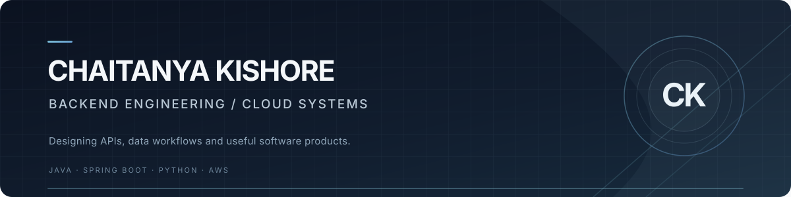

  

  <strong>Backend Developer · Java & Spring Boot · Cloud Systems</strong>
   
  <a href="https://chaitanya-portfolio-ivory.vercel.app/">Portfolio</a>
  &nbsp;·&nbsp;
  <a href="https://www.linkedin.com/in/chaitanya-kishore/">LinkedIn</a>
  &nbsp;·&nbsp;
  <a href="mailto:chaitanyakishorebatta@gmail.com">Email</a>
  &nbsp;·&nbsp;
  <a href="https://github.com/Chaitanya060">GitHub</a>

---

## Profile

I build backend applications and cloud-connected products, with a focus on API design, data workflows, integrations and practical system architecture. My work spans Java and Spring Boot, Python automation, JavaScript applications and cloud services.

I enjoy taking an idea from its core requirements through implementation, testing and deployment — while documenting the trade-offs that shape the system.

## Selected work

<table>
  <tr>
    <td width="50%" valign="top">
      <h3><a href="https://github.com/Chaitanya060/Seat-Siren">Seat-Siren</a></h3>
      
<strong>Availability alerts for cinema bookings</strong>

      
A product prototype designed to monitor booking availability and notify users through Telegram.

      
React · Cloudflare Workers · D1 · Firebase · Telegram Bot API

      
Engineering focus: scheduled polling, alert lifecycle, authentication and provider adapters.

      
Current integration note: the District provider is a mock adapter; live access is not connected.

    </td>
    <td width="50%" valign="top">
      <h3><a href="https://github.com/Chaitanya060/CloudSpend">CloudSpend</a></h3>
      
<strong>Cloud cost analytics and FinOps pipeline</strong>

      
An end-to-end workflow that transforms cloud billing data into a dimensional model and actionable dashboard insights.

      
Python · Pandas · SQLAlchemy · Streamlit · Plotly · AWS (optional layer)

      
Engineering focus: ETL, star-schema modelling, anomaly detection and 30-day forecasting.

    </td>
  </tr>
  <tr>
    <td width="50%" valign="top">
      <h3><a href="https://github.com/Chaitanya060/JobSearch">JobSearch</a></h3>
      
<strong>Job discovery and application preparation</strong>

      
A workflow for collecting job listings, enriching role information, tailoring application materials and preparing outreach for human review.

      
Python · Playwright · SQLite · Streamlit · GitHub Actions

      
Engineering focus: source adapters, deduplication, validation and human-in-the-loop automation.

    </td>
    <td width="50%" valign="top">
      <h3><a href="https://play.google.com/store/apps/details?id=com.credresolve.horoscopeapp&amp;hl=en_IN">Cosmic Horoscope</a></h3>
      
<strong>Published Android application</strong>

      
A mobile application for horoscope content and personalized astrology experiences, published on Google Play.

      
Flutter · Dart · Android

      
Engineering focus: mobile application development and integrating application services.

      
<a href="https://play.google.com/store/apps/details?id=com.credresolve.horoscopeapp&amp;hl=en_IN">View on Google Play</a>

    </td>
  </tr>
</table>

## Engineering toolkit

| Area | Technologies |
|---|---|
| Languages | Java, JavaScript, Python, Dart, SQL |
| Backend | Spring Boot, Spring MVC, Node.js, Express, REST APIs |
| Frontend & mobile | React, HTML, CSS, Flutter |
| Data & storage | PostgreSQL, MySQL, MongoDB, SQLite |
| Cloud & infrastructure | AWS, Cloudflare Workers, Firebase, Docker |
| Engineering tools | Git, GitHub Actions, Linux, Postman |

## What I focus on

- **Backend engineering:** API design, application structure, persistence and service integration.
- **Cloud systems:** serverless workflows, storage, deployment and operational considerations.
- **Data workflows:** ingestion, transformation, modelling and analytics.
- **Product delivery:** building usable features, documenting constraints and improving through iteration.

## More projects

- [ExpenseSharing](https://github.com/Chaitanya060/ExpenseSharing) — a full-stack expense-sharing application.
- [Travel](https://github.com/Chaitanya060/travel) — a Java and Spring Boot travel application.
- [Portfolio source](https://github.com/Chaitanya060/chaitanya_portfolio) — my personal portfolio website.

## Connect

For software engineering opportunities, project discussions or collaboration:

- **Email:** [chaitanyakishorebatta@gmail.com](mailto:chaitanyakishorebatta@gmail.com)
- **LinkedIn:** [chaitanya-kishore](https://www.linkedin.com/in/chaitanya-kishore/)
- **Portfolio:** [chaitanya-portfolio-ivory.vercel.app](https://chaitanya-portfolio-ivory.vercel.app/)

---

  Focused on building reliable software, understanding systems and getting better with every iteration.

